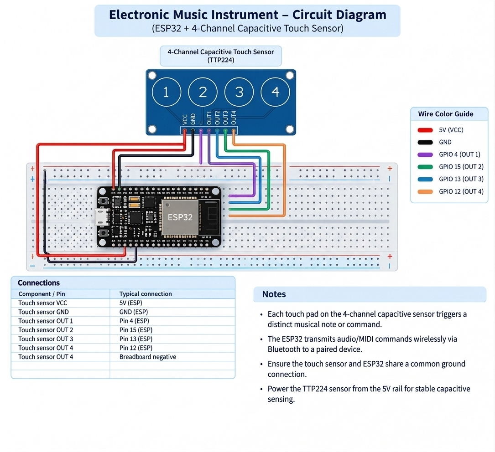

# Electronic Music Instrument

## Aim

To create a touch-controlled electronic musical instrument that communicates with a device through Bluetooth.

## What is the project?

A digital musical instrument in which touching a sensor triggers a musical note or sound command.

## How does it work?

1. The capacitive touch sensor detects contact with its sensing surface.
2. It sends a signal to the ESP32.
3. The ESP32 identifies the touch and executes the corresponding programmed instruction.
4. The device is then connected to the Bluetooth of the ESP32.
5. A compatible device or music application produces the sound, in the configured Bluetooth.

## Components used

- ESP32 microcontroller
- Capacitive touch sensor
- Jumper wires
- Bluetooth-compatible device

## Circuit Diagram

## Connections

| Component / Pin | Typical connection |
|---|---|
| Touch sensor VCC | 5V (ESP32) |
| Touch sensor GND | GND (ESP32) |
| Touch sensor OUT 1 | Pin 4 (ESP32) |
| Touch sensor OUT 2 | Pin 15 (ESP32) |
| Touch sensor OUT 3 | Pin 13 (ESP32) |
| Touch sensor OUT 4 | Pin 12 (ESP32) |

## Important wiring notes

- The uploaded document does not identify the exact capacitive touch sensor model. Confirm that your module has four separate outputs and check its pin labels.
- Check the sensor's output voltage before connecting it to the ESP32. ESP32 GPIO pins use 3.3V logic; a 5V output must not be connected directly.
- Bluetooth pairing and sound production depend on the program and the compatible device. The source document does not specify the software configuration or an audio-output circuit.
